# PRAKTIKUM 6: JAVASCRIPT DOM DAN EVENT HANDLING

## A. Identitas Praktikum

- Mata Kuliah: Pemrograman Web
- Pertemuan: 7
- Topik: JavaScript DOM dan Event Handling
- Nama Folder: `lab6_dom_event`

## B. Tujuan Praktikum

1. Memahami DOM sebagai representasi dokumen HTML yang dapat diakses melalui JavaScript.
2. Menggunakan id, class, dan selector CSS untuk memilih elemen HTML.
3. Mengubah teks, atribut, kelas CSS, dan gaya elemen melalui JavaScript.
4. Menangani event pengguna menggunakan `addEventListener()`.
5. Membuat validasi form dan menampilkan pesan sesuai kondisi input.
6. Mengembangkan halaman interaktif dengan minimal tiga fungsi yang berjalan benar.

## C. Persiapan Praktikum

Praktikum dilakukan menggunakan Visual Studio Code dan browser.

Langkah persiapan:

1. Membuat folder kerja bernama `lab6_dom_event`.
2. Membuat file `index.html`, `style.css`, dan `script.js`.
3. Menghubungkan file CSS dan JavaScript ke dalam HTML.
4. Membuka halaman menggunakan browser atau Live Server.
5. Mengaktifkan Developer Tools/Console untuk memeriksa hasil program.

## D. Struktur Folder

```text
lab6_dom_event/
│
├── index.html
├── style.css
├── script.js
├── README.md
│
└── image/
    ├── Latihan1.png
    ├── Latihan1.1.png
    ├── Latihan2.png
    ├── Latihan3.png
    ├── Latihan4.png
    ├── Latihan5a.png
    ├── Latihan5b.png
    ├── Latihan6.png
    ├── MiniProject1.png
    ├── MiniProject2.png
    ├── MiniProject3.png
    ├── Eksperimen1.png
    ├── Eksperimen2.png
    ├── Eksperimen3.png
    ├── Eksperimen4.png
    └── Eksperimen5.png
```

## E. Langkah Kerja Praktikum

### 1. Latihan 1 - Mengubah Teks dengan DOM

Pada latihan pertama dilakukan pemilihan elemen HTML berdasarkan id menggunakan `getElementById()`. Selanjutnya, isi judul dan paragraf diubah menggunakan `textContent`.

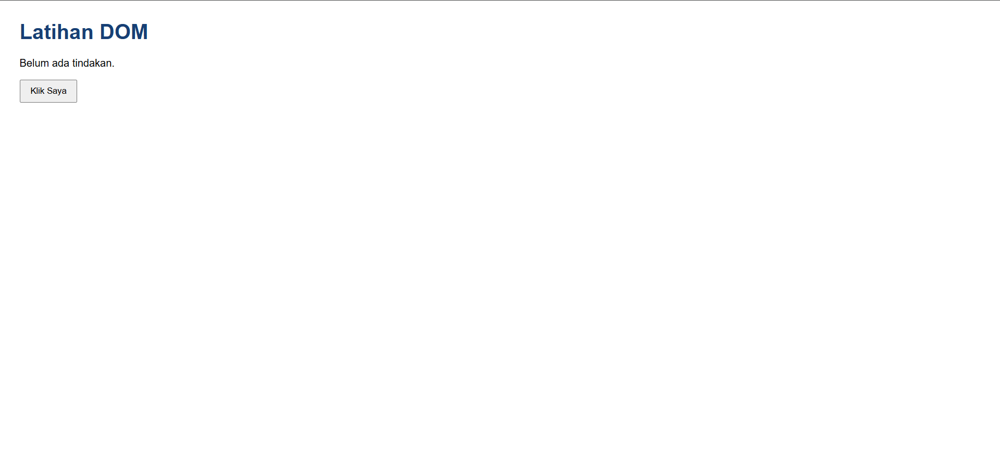
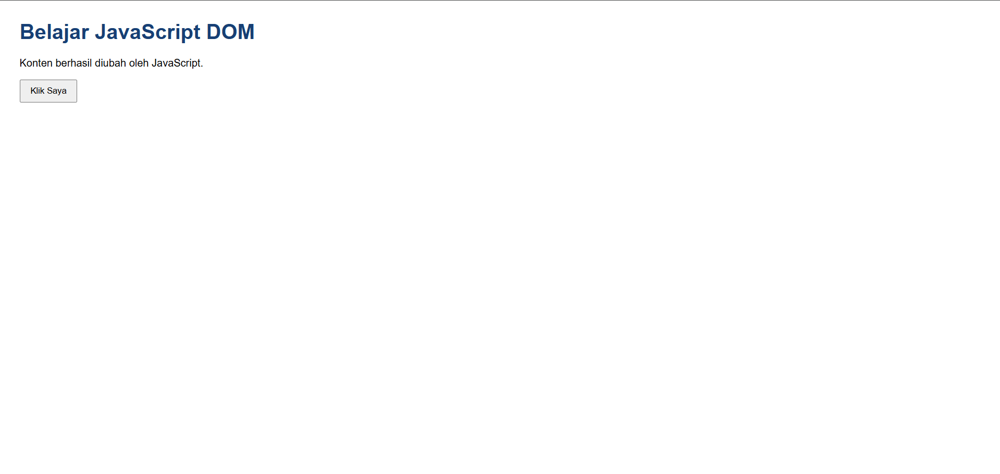

### 2. Latihan 2 - Event Click

Pada latihan kedua digunakan `addEventListener()` dengan event `click`. Ketika tombol ditekan, program akan mengubah isi paragraf dan menampilkan waktu saat tombol diklik.

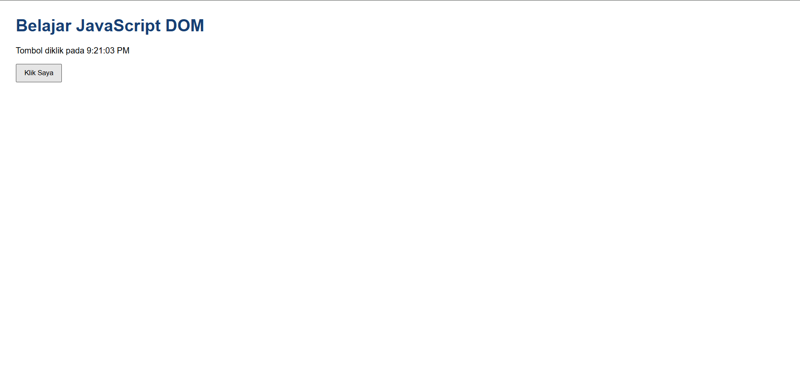

### 3. Latihan 3 - Mengubah Kelas dan Gaya CSS

Pada latihan ketiga digunakan `classList.toggle()` untuk menambahkan atau menghapus class CSS pada elemen paragraf. Ketika tombol ditekan, tampilan teks akan berubah.

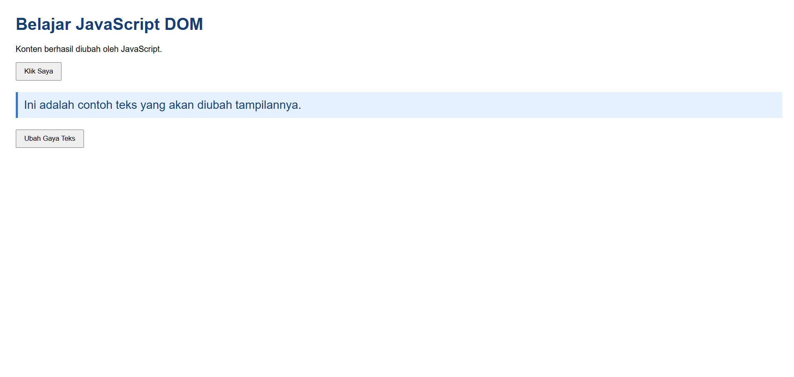

### 4. Latihan 4 - Event Input dan Penghitung Karakter

Pada latihan keempat dibuat input teks dan penghitung jumlah karakter. Program menggunakan event `input` sehingga jumlah karakter akan diperbarui secara langsung ketika pengguna mengetik, menghapus, atau menempelkan teks.

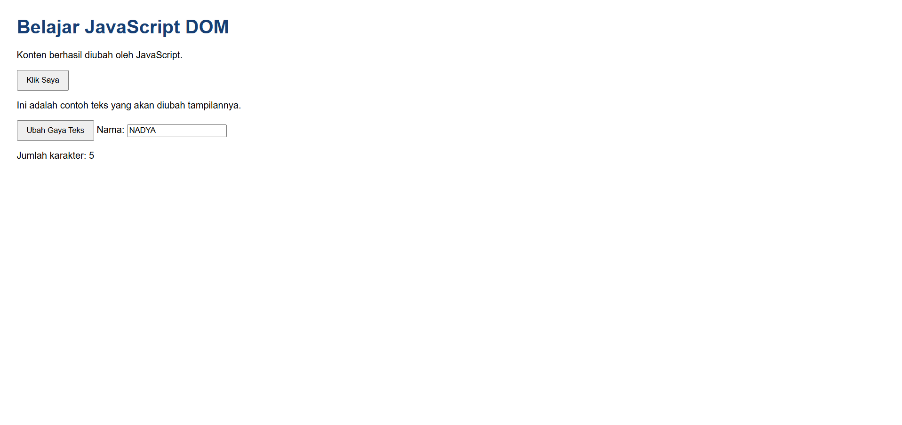

### 5. Latihan 5 - Validasi Form Pendaftaran

Pada latihan kelima dibuat form pendaftaran yang terdiri dari nama lengkap, email, dan usia.

Validasi dilakukan untuk memastikan nama tidak kosong, email memiliki format yang benar, dan usia berupa bilangan bulat antara 17 sampai 100 tahun.

Pengujian dilakukan dengan lima kondisi:
1. Semua kolom dikosongkan.
2. Nama tidak diisi.
3. Email tidak valid.
4. Usia di bawah 17 tahun.
5. Semua data diisi dengan benar.

**Hasil pengujian kondisi tidak valid:**

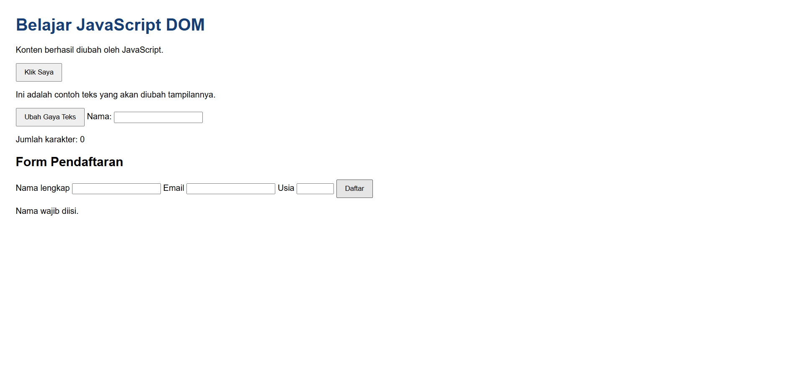

**Hasil pengujian kondisi valid:**

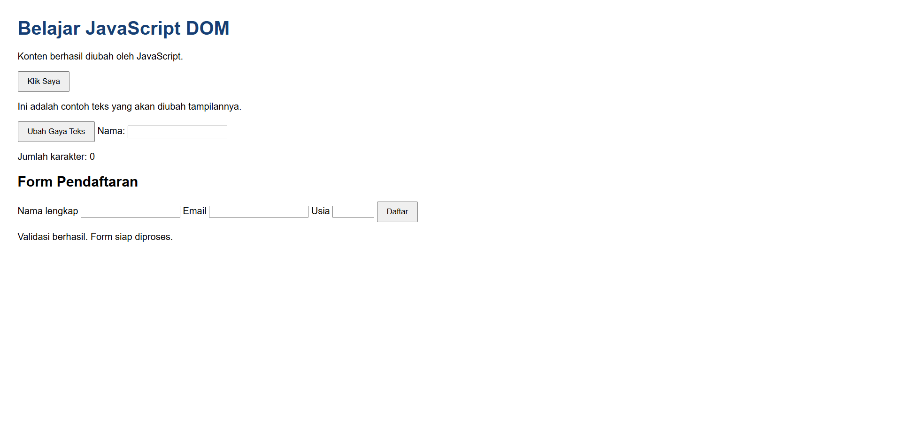

### 6. Latihan 6 - Daftar Tugas (To-do List)

Pada latihan keenam dibuat aplikasi daftar tugas sederhana. Pengguna dapat menambahkan tugas dan menandai tugas yang sudah selesai.

Program menggunakan `createElement()` untuk membuat elemen baru, `appendChild()` untuk menambahkan tugas ke daftar, dan `classList.toggle()` untuk mengubah status tugas.

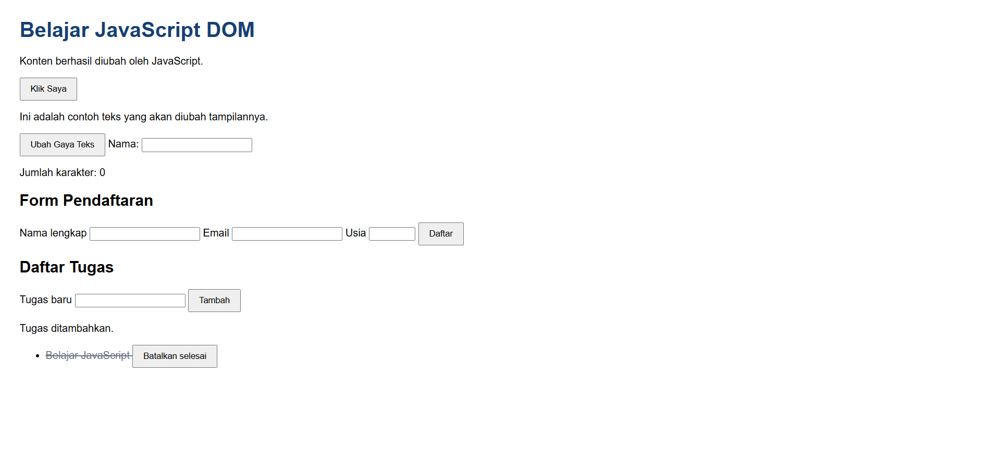

## F. Mini Project - Form Pendaftaran Workshop

Pada Mini Project dibuat halaman pendaftaran workshop dengan beberapa fungsi interaktif, yaitu:

1. Validasi nama minimal tiga karakter.
2. Validasi format email.
3. Pilihan sesi workshop pagi, siang, dan sore.
4. Penghitung jumlah karakter nama.
5. Ringkasan sesi yang dipilih.
6. Pesan kesalahan dan pesan berhasil.
7. Tombol reset untuk mengosongkan input.

**Tampilan form pendaftaran workshop:**

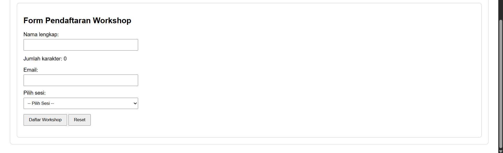

**Pengujian form dengan data tidak valid:**

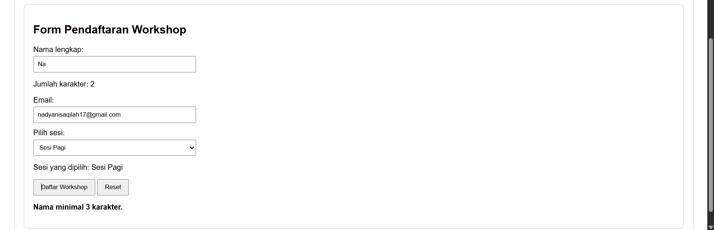

**Pengujian form dengan data valid:**

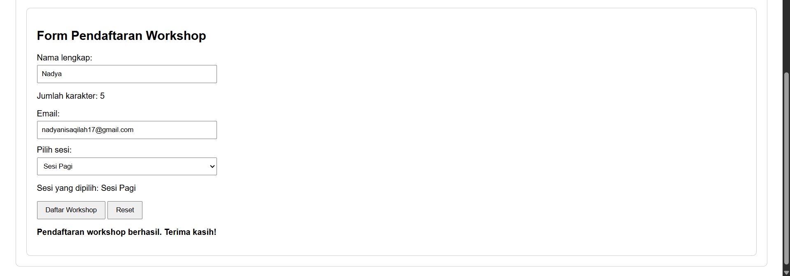

## G. Eksperimen Mandiri

### 1. Eksperimen 1 - Menambahkan Tombol Hapus

Pada eksperimen pertama ditambahkan tombol Hapus pada setiap item To-do List. Tombol tersebut menggunakan fungsi `remove()` untuk menghapus satu tugas yang dipilih.

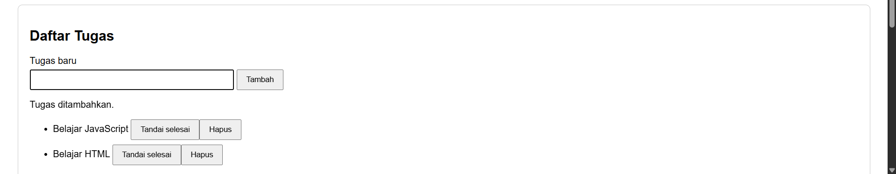

### 2. Eksperimen 2 - Validasi Nama Minimal Tiga Karakter

Pada eksperimen kedua dilakukan perubahan validasi agar nama yang dimasukkan minimal terdiri dari tiga karakter. Jika nama kurang dari tiga karakter, program akan menampilkan pesan kesalahan.


### 3. Eksperimen 3 - Event Change pada Dropdown

Pada eksperimen ketiga digunakan event `change` pada dropdown pilihan sesi workshop. Ketika pengguna memilih sesi, program akan menampilkan informasi sesi yang dipilih.

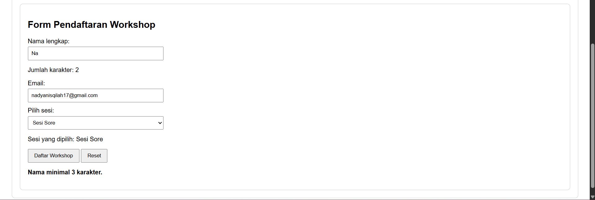

### 4. Eksperimen 4 - Menyembunyikan dan Menampilkan Teks

Pada eksperimen keempat dibuat tombol untuk menyembunyikan dan menampilkan paragraf. Proses ini dilakukan menggunakan class CSS dan `classList.toggle()`.

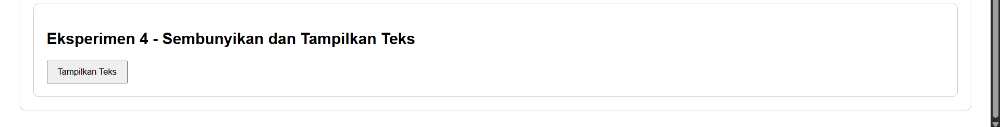

### 5. Eksperimen 5 - Memindahkan Script Tanpa Defer

Pada eksperimen kelima dilakukan percobaan dengan memindahkan pemanggilan file JavaScript ke bagian `<head>` tanpa menggunakan atribut `defer`.

Hasil pengamatan menunjukkan munculnya error karena JavaScript dijalankan sebelum elemen HTML selesai diproses. Akibatnya, elemen yang dicari belum tersedia ketika JavaScript mencoba mengubah isinya.

Setelah pengamatan selesai, atribut `defer` dikembalikan agar JavaScript dijalankan setelah HTML selesai diproses.

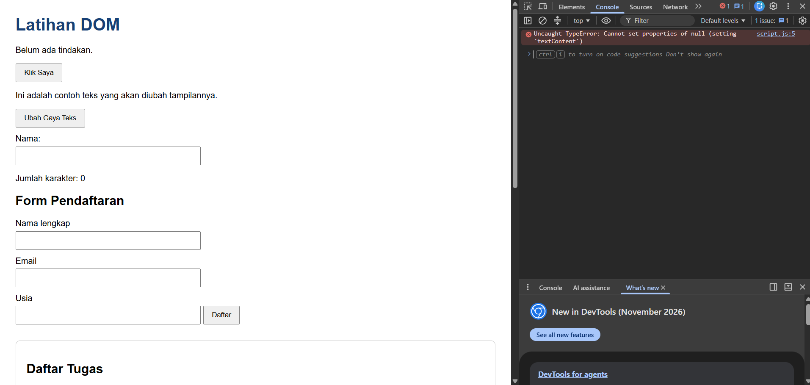

## H. Pertanyaan Evaluasi

### 1. Apa yang dimaksud dengan DOM dan apa manfaatnya?

DOM (Document Object Model) adalah representasi struktur dokumen HTML dalam bentuk objek yang dapat diakses dan dimanipulasi menggunakan JavaScript.

Manfaat DOM adalah untuk memilih elemen HTML, mengubah isi halaman, mengatur tampilan, menambahkan atau menghapus elemen, serta membuat halaman web menjadi interaktif.

### 2. Apa perbedaan getElementById(), querySelector(), dan querySelectorAll()?

- `getElementById()` digunakan untuk memilih elemen berdasarkan id.
- `querySelector()` digunakan untuk memilih elemen pertama yang sesuai dengan selector CSS.
- `querySelectorAll()` digunakan untuk memilih semua elemen yang sesuai dengan selector CSS.

### 3. Apa fungsi addEventListener() dan sebutkan tiga contoh event?

`addEventListener()` berfungsi untuk menghubungkan suatu event dengan fungsi yang akan dijalankan ketika event tersebut terjadi.

Contoh event:
- `click`: ketika elemen diklik.
- `input`: ketika isi input berubah.
- `submit`: ketika form dikirim.

### 4. Mengapa event.preventDefault() digunakan pada event submit form?

`event.preventDefault()` digunakan untuk mencegah tindakan bawaan browser ketika form dikirim, seperti memuat ulang halaman. Dengan begitu, JavaScript dapat memeriksa data terlebih dahulu dan menampilkan pesan validasi.

### 5. Apa perbedaan textContent dan innerHTML dari sisi penggunaan dan keamanan?

`textContent` digunakan untuk mengubah atau menampilkan teks biasa pada elemen HTML.

Sedangkan `innerHTML` digunakan untuk mengubah isi elemen menggunakan markup HTML.

Dari sisi keamanan, `textContent` lebih aman untuk menampilkan input pengguna karena teks tidak diproses sebagai kode HTML. Penggunaan `innerHTML` dengan data pengguna yang tidak dipercaya dapat menimbulkan risiko keamanan.

### 6. Bagaimana classList.toggle() membantu mengubah tampilan elemen?

`classList.toggle()` digunakan untuk menambahkan class CSS jika class belum ada dan menghapusnya jika class sudah ada.

Dengan fungsi ini, tampilan elemen dapat diubah secara bergantian, misalnya untuk memperbesar teks, memberi warna, atau menyembunyikan paragraf.

### 7. Sebutkan minimal tiga skenario pengujian validasi form.

Contoh skenario pengujian validasi form:

1. Semua kolom dikosongkan untuk memastikan program menampilkan pesan bahwa nama wajib diisi.
2. Email diisi dengan format yang salah untuk memastikan program menampilkan pesan email tidak valid.
3. Usia diisi kurang dari 17 tahun untuk memastikan program menolak usia yang tidak sesuai.
4. Semua data diisi dengan benar untuk memastikan program menampilkan pesan validasi berhasil.

## I. Hasil dan Pengujian

Berdasarkan praktikum yang telah dilakukan, fitur-fitur yang berhasil diterapkan adalah:

1. Mengubah isi elemen HTML menggunakan DOM.
2. Menampilkan waktu ketika tombol diklik.
3. Mengubah tampilan elemen menggunakan class CSS.
4. Menghitung jumlah karakter secara langsung.
5. Melakukan validasi form pendaftaran.
6. Menambahkan dan menandai tugas yang sudah selesai.
7. Menghapus item dari daftar tugas.
8. Membuat form pendaftaran workshop.
9. Menampilkan sesi workshop yang dipilih.
10. Menyembunyikan dan menampilkan paragraf.

## J. Cara Menjalankan Program

1. Buka folder `lab6_dom_event` menggunakan Visual Studio Code.
2. Pastikan file `index.html`, `style.css`, dan `script.js` tersedia.
3. Pastikan file CSS dan JavaScript sudah terhubung dengan HTML.
4. Buka file `index.html` menggunakan browser atau Live Server.
5. Coba setiap latihan dan fitur yang tersedia.
6. Periksa hasil program untuk memastikan setiap fungsi berjalan dengan baik.

## K. Kesimpulan

Dari praktikum JavaScript DOM dan Event Handling ini, dapat dipahami bahwa JavaScript memiliki peran penting dalam membuat halaman web menjadi lebih interaktif.

Melalui latihan yang telah dilakukan, saya dapat mempelajari cara memilih elemen HTML, mengubah isi dan tampilan halaman, menangani event pengguna, serta melakukan validasi form.

Mini Project dan Eksperimen Mandiri juga memberikan pengalaman dalam menerapkan JavaScript untuk membuat fitur sederhana pada halaman web.

## L. Referensi

1. Rencana Pembelajaran Semester (RPS) Mata Kuliah Pemrograman Web, Pertemuan 7: JavaScript DOM dan Event Handling.
2. MDN Web Docs. Introduction to the DOM. https://developer.mozilla.org/en-US/docs/Web/API/Document_Object_Model/Introduction
3. MDN Web Docs. Event Reference. https://developer.mozilla.org/en-US/docs/Web/Events
4. MDN Web Docs. Client-side Form Validation. https://developer.mozilla.org/en-US/docs/Learn/Forms/Form_validation